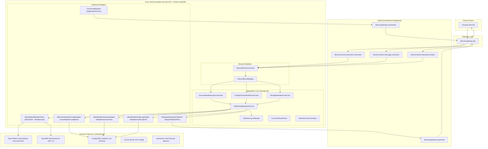
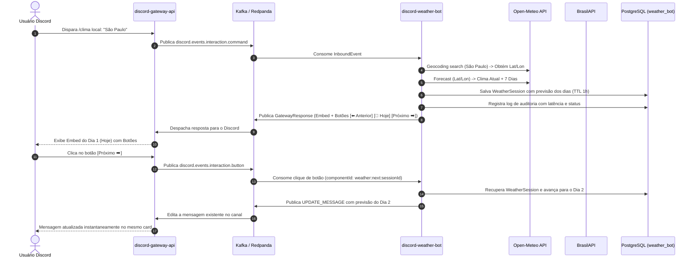

# ⛅ Discord Weather Bot

[](https://openjdk.org/)
[-JDK%2025-red?logo=graalvm)](https://www.graalvm.org/)
[](https://spring.io/projects/spring-boot)
[](https://open-meteo.com/)
[](https://www.postgresql.org/)
[](https://kafka.apache.org/)
[](https://resilience4j.readme.io/)

O **Discord Weather Bot** é um microsserviço corporativo de previsão meteorológica orientado a eventos para comunidades no Discord. Desenvolvido sobre o **Java 25 com Oracle GraalVM (GFTC)** em compilação nativa (**Native Image**) e **Spring Boot 4**, ele adota os princípios de **Arquitetura Hexagonal (Ports and Adapters)**, operando de forma reativa e desacoplada via **Kafka / Redpanda**.

O bot integra APIs públicas de clima e geocodificação (**Open-Meteo** e **BrasilAPI** para CEPs brasileiros), permitindo aos usuários consultar a temperatura atual, sensação térmica, umidade, vento, probabilidade de chuva, índice UV e previsão estendida para 7 dias. Ele oferece navegação dinâmica por botões interativos do Discord (Anterior, Hoje, Próximo) que atualizam a mesma mensagem em tempo real, suporte a localização padrão por usuário (`/clima-config`), e trilha completa de auditoria persistida em **PostgreSQL**.

---

## 🏛️ Blueprint da Arquitetura

O bot opera de forma desacoplada do Discord: o **discord-gateway-api** consome os eventos da API do Discord e os publica em tópicos Kafka. O `discord-weather-bot` consome os comandos `/clima`, `/clima-config`, `.clima` e as interações de botões, consulta as APIs públicas de clima sob proteção de circuit breakers e publica as respostas prontas com embeds e botões de volta ao Gateway.



---

## ⚡ Fluxo de Execução e Paginação Interativa



---

## 📂 Estrutura Hexagonal do Projeto

```
src/
├── main/
│   ├── java/dev/gdinizds/discordweatherbot/
│   │   ├── DiscordWeatherBotApplication.java
│   │   ├── domain/
│   │   │   ├── model/
│   │   │   │   ├── Location.java                 # Value Object de coordenadas e localização
│   │   │   │   ├── CurrentWeather.java           # Temperatura atual, sensação, vento e umidade
│   │   │   │   ├── DailyForecast.java            # Previsão diária com índices de chuva e UV
│   │   │   │   ├── WeatherForecast.java          # Agregado da previsão atual + diária
│   │   │   │   ├── WeatherSession.java           # Sessão de navegação interativa entre dias
│   │   │   │   ├── UserWeatherConfig.java        # Localização padrão configurada pelo usuário
│   │   │   │   ├── WeatherAuditLog.java          # Registro imutável de auditoria
│   │   │   │   ├── WeatherQueryCommand.java      # Comando de consulta de clima
│   │   │   │   ├── ConfigureWeatherCommand.java  # Comando de configuração de favorito
│   │   │   │   ├── WeatherNavigationCommand.java # Comando de navegação por botões
│   │   │   │   └── OutboundResponse.java         # Resposta para o Discord com Embeds e Botões
│   │   │   └── service/
│   │   │       ├── WeatherCodeTranslator.java    # Tradutor de códigos WMO para emojis e descrições
│   │   │       ├── CommandTextParser.java        # Parser flexível para comandos .clima
│   │   │       └── WeatherLayoutBuilder.java     # Renderizador de Embeds e ActionRows
│   │   ├── application/
│   │   │   ├── port/
│   │   │   │   ├── in/
│   │   │   │   │   ├── ExecuteWeatherQueryUseCase.java
│   │   │   │   │   ├── ConfigureUserWeatherUseCase.java
│   │   │   │   │   └── NavigateWeatherUseCase.java
│   │   │   │   └── out/
│   │   │   │       ├── WeatherClientPort.java
│   │   │   │       ├── UserWeatherConfigPort.java
│   │   │   │       ├── WeatherSessionPort.java
│   │   │   │       ├── WeatherAuditLogPort.java
│   │   │   │       └── ReplyPublisherPort.java
│   │   │   └── service/
│   │   │       ├── WeatherApplicationService.java
│   │   │       └── Mdc.java
│   │   ├── adapter/
│   │   │   ├── in/kafka/
│   │   │   │   ├── InboundEvent.java
│   │   │   │   ├── InboundEventMapper.java
│   │   │   │   └── InboundEventConsumer.java
│   │   │   └── out/
│   │   │       ├── openmeteo/OpenMeteoWeatherClient.java
│   │   │       ├── persistence/
│   │   │       │   ├── JdbcUserWeatherConfigAdapter.java
│   │   │       │   ├── JdbcWeatherSessionAdapter.java
│   │   │       │   └── JdbcWeatherAuditLogAdapter.java
│   │   │       └── kafka/
│   │   │           ├── GatewayResponse.java
│   │   │           ├── GatewayResponsePublisher.java
│   │   │           └── CommandRegistrar.java
│   │   └── config/
│   │       ├── ApplicationConfig.java
│   │       ├── WeatherBotProperties.java
│   │       ├── KafkaConfig.java
│   │       ├── ResilienceConfig.java
│   │       ├── Resilience.java
│   │       └── NativeRuntimeHints.java
│   └── resources/
│       ├── application.yaml
│       └── db/migration/
│           └── V1__init_weather_schema.sql
└── test/
    └── java/dev/gdinizds/discordweatherbot/
        ├── arch/ArchitectureTest.java            # ArchUnit validando arquitetura hexagonal
        ├── domain/
        ├── application/
        └── adapter/
```

---

## 🎯 Comandos Suportados

### 1. Slash Command: `/clima`
Registrado automaticamente no Discord Gateway via `discord.gateway.commands`.

| Parâmetro | Tipo | Obrigatório | Descrição | Exemplo |
| :--- | :--- | :---: | :--- | :--- |
| `local` | `STRING` | Não | Cidade ou CEP/Zipcode (opcional se você já configurou seu padrão) | `São Paulo` ou `01001-000` |
| `estado` | `STRING` | Não | Estado ou UF | `SP` |
| `pais` | `STRING` | Não | País | `Brasil` |

> Caso executado sem parâmetros, o bot consulta automaticamente a localização padrão configurada para o usuário. Se ainda não houver configuração, exibe instruções amigáveis para definição.

### 2. Slash Command: `/clima-config`
Configura a localização padrão exclusiva do usuário. A resposta é enviada de forma efêmera (`EPHEMERAL_REPLY`), visível somente para ele.

| Parâmetro | Tipo | Obrigatório | Descrição | Exemplo |
| :--- | :--- | :---: | :--- | :--- |
| `cidade` | `STRING` | **Sim** | Sua cidade ou CEP padrão | `Curitiba` |
| `estado` | `STRING` | Não | Estado ou UF padrão | `PR` |
| `pais` | `STRING` | Não | País padrão | `Brasil` |

### 3. Dot Command: `.clima` e `.clima-config`
Processa mensagens de texto comuns com prefixo `.`:

```bash
# Consulta usando a localização padrão salva
.clima

# Consulta informando cidade ou CEP
.clima Curitiba
.clima 01001-000
.clima Rio de Janeiro, RJ, Brasil

# Configuração de localização padrão do usuário
.clima config Florianópolis, SC, Brasil
.clima configure Belo Horizonte
.clima-config Salvador, BA, Brasil
```

---

## 🌤️ Layout e Navegação Interativa

A resposta do bot é estruturada com Embeds ricos e dinâmicos:

- **Embed Principal:**
  - **Título:** Emoji temático da condição + Nome completo da localidade (`☀️ Clima em São Paulo, SP - Brasil`).
  - **Cor do Embed:** Dinâmica baseada na condição meteorológica (amarelo para ensolarado, azul para chuva, roxo para tempestades, etc.).
  - **Destaque:** Temperatura atual em tamanho grande, sensação térmica e descrição da condição WMO.
  - **Campos Detalhados:**
    - `🌡️ Máx / Mín`: Temperaturas extremas do dia.
    - `💧 Umidade`: Umidade relativa do ar em percentual.
    - `💨 Vento`: Velocidade do vento em km/h.
    - `🌧️ Chuva`: Probabilidade (%) e volume acumulado (mm).
    - `☀️ Índice UV`: Escala de radiação ultravioleta.
    - `📅 Data`: Dia da semana e data completa formatada em português.
  - **Visão Semanal:** Resumo dos próximos dias com mínimas, máximas e probabilidades de chuva.
- **Botões Interativos (ActionRow):**
  - `⬅️ Anterior`: retrocede um dia na previsão (desabilitado no dia de hoje).
  - `📅 Hoje`: retorna instantaneamente para a previsão do dia atual.
  - `Próximo ➡️`: avança para o próximo dia da previsão (desabilitado no 7º dia).

---

## 📊 Persistência e Tabela de Auditoria (PostgreSQL)

O schema `weather_bot` é versionado via **Flyway** e armazena:

```sql
CREATE TABLE weather_bot.user_weather_config (
    id BIGSERIAL PRIMARY KEY,
    user_id VARCHAR(32) NOT NULL UNIQUE,
    city VARCHAR(128) NOT NULL,
    state VARCHAR(64),
    country VARCHAR(64),
    latitude DOUBLE PRECISION NOT NULL,
    longitude DOUBLE PRECISION NOT NULL,
    timezone VARCHAR(64) NOT NULL,
    created_at TIMESTAMPTZ NOT NULL DEFAULT NOW(),
    updated_at TIMESTAMPTZ NOT NULL DEFAULT NOW()
);

CREATE TABLE weather_bot.weather_sessions (
    id BIGSERIAL PRIMARY KEY,
    session_id VARCHAR(64) NOT NULL UNIQUE,
    guild_id VARCHAR(32),
    channel_id VARCHAR(32),
    user_id VARCHAR(32) NOT NULL,
    origin_message_id VARCHAR(32),
    location_name VARCHAR(256) NOT NULL,
    location_state VARCHAR(64),
    location_country VARCHAR(64),
    latitude DOUBLE PRECISION NOT NULL,
    longitude DOUBLE PRECISION NOT NULL,
    timezone VARCHAR(64) NOT NULL,
    current_day_index INT NOT NULL DEFAULT 0,
    forecast_json TEXT NOT NULL,
    expires_at TIMESTAMPTZ NOT NULL,
    created_at TIMESTAMPTZ NOT NULL DEFAULT NOW(),
    updated_at TIMESTAMPTZ NOT NULL DEFAULT NOW()
);

CREATE TABLE weather_bot.weather_audit_log (
    id BIGSERIAL PRIMARY KEY,
    correlation_id VARCHAR(64) NOT NULL,
    guild_id VARCHAR(32),
    channel_id VARCHAR(32),
    user_id VARCHAR(32) NOT NULL,
    command_name VARCHAR(32) NOT NULL,
    trigger_type VARCHAR(16) NOT NULL,
    query_location VARCHAR(256),
    resolved_location VARCHAR(256),
    status VARCHAR(32) NOT NULL,
    raw_request TEXT,
    raw_response TEXT,
    execution_time_ms BIGINT NOT NULL,
    created_at TIMESTAMPTZ NOT NULL DEFAULT NOW()
);
```

---

## 🛡️ Resiliência com Resilience4j

Todas as chamadas para serviços externos contam com proteção de falha em cascata:

| Alvo | Circuit Breaker | Retry | Time Limiter | Bulkhead |
| :--- | :---: | :---: | :---: | :---: |
| **Open-Meteo Weather API** | 50% falha, janela de 10 | 2 tentativas com backoff | 6s | - |
| **BrasilAPI (CEP)** | 50% falha, janela de 10 | 2 tentativas | 4s | - |
| **PostgreSQL Database** | 50% falha, janela de 20 | 3 tentativas | - | - |
| **Processamento Concorrente** | - | - | - | 32 chamadas simultâneas |

---

## 🚀 Compilação Nativa com Oracle GraalVM (GFTC)

O binário nativo é gerado pelo plugin `org.graalvm.buildtools.native` utilizando a imagem oficial da Oracle:

```dockerfile
FROM container-registry.oracle.com/graalvm/native-image:25 AS build
WORKDIR /workspace
COPY . .
RUN ./gradlew nativeCompile --no-daemon -x test

FROM debian:bookworm-slim AS runtime
WORKDIR /app
COPY --from=build /workspace/build/native/nativeCompile/discord-weather-bot /app/discord-weather-bot
USER 1001
ENTRYPOINT ["/app/discord-weather-bot", "-XX:MaximumHeapSizePercent=50"]
```

Benefícios da execução nativa:
- **Tempo de Inicialização:** < 80ms para ficar pronto e responder ao Kafka.
- **Consumo de Memória Base:** ~45MB RSS (em comparação aos ~350MB de uma JVM tradicional).
- **Segurança:** Superfície de ataque reduzida com contêiner `debian:bookworm-slim` sem ferramentas de desenvolvimento e sem execução como root.

---

## 🚢 Deploy no Kubernetes via GitOps (FluxCD)

O ciclo de vida no cluster é gerenciado através do repositório GitOps [fleet-infra](https://github.com/gdinizds/fleet-infra.git):

- **Injeção de Segredos pelo HashiCorp Vault:**
  - Banco de Dados: `secret/discord-weather-bot/db`
- **Configurações Centralizadas no Consul:**
  - Carregadas automaticamente via Spring Cloud Consul Config em `consul-server.consul.svc.cluster.local:8500`.
- **Image Update Automation do Flux:**
  - A cada nova tag gerada no GitHub (`v*.*.*`), o GitHub Actions constrói a imagem no GHCR e o Flux aplica a atualização no cluster via RollingUpdate.

---

## 🛠️ Comandos de Desenvolvimento

```bash
# Executar todos os testes automatizados
./gradlew test

# Executar aplicação localmente
./gradlew bootRun

# Compilar binário nativo localmente
./gradlew nativeCompile
```
